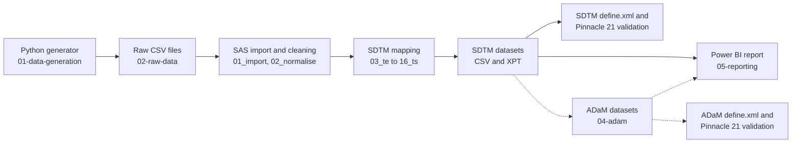

# LORNA Clinical Trial: End-to-End Clinical Data Project

An end-to-end clinical programming project built around **LORNA (DLF552)**, a simulated Phase II trial in chronic liver disease. Synthetic raw data are generated in Python, cleaned and mapped to CDISC SDTM in SAS, and explored in a Power BI report. The SDTM datasets have a define.xml and have passed Pinnacle 21 validation with no FDA rejection criteria; the analysis datasets (ADaM) are the next stage.

Each stage has its own folder, numbered in the order the work is done, and each folder has a README that explains its contents in detail. This page gives the overall picture and links to everything else.

> All data in this repository are synthetic. No real patient information is used, stored or processed.

---

## Contents

1. [Project status](#1-project-status)
2. [Repository structure](#2-repository-structure)
3. [The simulated trial](#3-the-simulated-trial)
4. [Workflow](#4-workflow)
5. [Stage 1: Data generation](#5-stage-1-data-generation)
6. [Stage 2: Raw data and intentional data quality issues](#6-stage-2-raw-data-and-intentional-data-quality-issues)
7. [Stage 3: Data cleaning and normalisation](#7-stage-3-data-cleaning-and-normalisation)
8. [Stage 4: SDTM mapping](#8-stage-4-sdtm-mapping)
9. [Stage 5: Reporting in Power BI](#9-stage-5-reporting-in-power-bi)
10. [Study documents](#10-study-documents)
11. [Roadmap](#11-roadmap)
12. [How to reproduce the work](#12-how-to-reproduce-the-work)
13. [Standards and tools](#13-standards-and-tools)
14. [Disclaimer](#14-disclaimer)

---

## 1. Project status

| Stage | Description | Status | Location |
|---|---|---|---|
| Study documents | Protocol with statistical analysis plan, eCRF, annotated CRF | Complete | [`docs/`](docs/) |
| Data generation | Python script that simulates the trial | Complete | [`01-data-generation/`](01-data-generation/) |
| Raw data | 10 CSV files produced by the script | Complete | [`02-raw-data/`](02-raw-data/) |
| Cleaning and SDTM mapping | 18 SAS programs; 14 SDTM domains as CSV and XPT | Complete | [`03-sdtm/`](03-sdtm/) |
| Reporting | Power BI report on the SDTM domains, refreshed with the validated datasets | Complete | [`05-reporting/`](05-reporting/) |
| SDTM define.xml | Define-XML v2.1 metadata for the SDTM domains | Complete | [`03-sdtm/define/`](03-sdtm/define/) |
| SDTM validation | Pinnacle 21 Community report: 14 messages, none blocking, each explained | Complete | [`03-sdtm/validation/`](03-sdtm/validation/) |
| ADaM datasets | Analysis datasets defined by the SAP | Planned | [`04-adam/`](04-adam/) |
| ADaM define.xml and validation | Define-XML v2.1 and Pinnacle 21 report for ADaM | Planned | [`04-adam/`](04-adam/) |

---

## 2. Repository structure

```
LORNA-clinical-data-project/
│
├── README.md                          This file: project overview and navigation
│
├── docs/                              Study documents
│   ├── LORNA-Trial-Protocol-v1.1.pdf  Protocol, including the SAP (Section 8)
│   ├── LORNA-eCRF.pdf                 Electronic case report form
│   └── LORNA-aCRF.pdf                 CRF annotated with SDTM variables
│
├── 01-data-generation/                Stage 1: simulate the trial in Python
│   ├── random_CT_data_generator_v3.py
│   ├── tutorial.md                    How the generator works and how to change it
│   └── data_dictionary.md             Variables in each raw CSV file
│
├── 02-raw-data/                       Stage 2: raw output of the generator (unchanged)
│   └── *.csv                          10 files: subjects, visits, labs, vitals, ...
│
├── 03-sdtm/                           Stages 3 and 4: cleaning and SDTM mapping in SAS
│   ├── programs/                      00_libname.sas ... 17_export.sas, in run order
│   ├── datasets/
│   │   ├── csv/                       14 SDTM domains as CSV
│   │   └── xpt/                       14 SDTM domains as SAS transport version 5 files
│   ├── define/                        define.xml, stylesheet, Excel spec and aCRF copy
│   └── validation/                    Pinnacle 21 report and issues summary
│
├── 04-adam/                           Stage 6: ADaM datasets (planned)
│   ├── programs/
│   ├── datasets/csv/ and datasets/xpt/
│   ├── define/
│   └── validation/
│
└── 05-reporting/                      Stage 5: Power BI report
    └── LORNA-Clinical-Trial-Report.pbix
```

The folders are numbered in the order data flows through the project. Reporting is numbered after ADaM because, once the ADaM datasets exist, the report will draw on them as well as on SDTM.

---

## 3. The simulated trial

The data follow a sample protocol written for this project. The full protocol, including the statistical analysis plan (SAP), is in [`docs/LORNA-Trial-Protocol-v1.1.pdf`](docs/LORNA-Trial-Protocol-v1.1.pdf).

| Item | Detail |
|---|---|
| Study | LORNA (protocol DLF552) |
| Phase and design | Phase II, randomised, double-blind, placebo-controlled, parallel groups |
| Population | Adults aged 18 to 85 with chronic liver disease, at 4 sites in the USA |
| Subjects | 300 randomised: Drug A 86, Drug B 110, placebo 104 |
| Treatment | One tablet every 4 weeks (Days 1, 29, 57 and 85): Drug A 200 mg, Drug B 300 mg or placebo |
| Follow-up | One visit 4 weeks after the last dose (Week 16, Day 113) |
| Study dates | Screening from December 2022; last subject contact in February 2024 |
| Primary efficacy endpoints | Change from baseline to Week 12 in ALT, AST and CRP, each active drug against placebo |
| Primary safety endpoint | Incidence, severity and relationship of treatment-emergent adverse events |
| Analysis populations | Intent-to-treat, full analysis set, safety and per-protocol (SAP Section 8.3) |

### Visit schedule

| Visit | Planned day | Main assessments |
|---|---|---|
| Screening | -14 | Informed consent, eligibility, demographics, medical history, medications, vital signs, laboratory tests |
| Baseline | 1 | Pre-dose vital signs and laboratory tests, randomisation, first dose |
| Week 4 | 29 | Vital signs, laboratory tests, second dose, adverse event review |
| Week 8 | 57 | Vital signs, laboratory tests, third dose, adverse event review |
| Week 12 | 85 | Vital signs, laboratory tests, fourth and final dose, adverse event review |
| Follow-up | 113 | Vital signs, laboratory tests, adverse event review, end of study |

Laboratory tests are ALT, AST and CRP (chemistry) and haemoglobin (haematology). Vital signs are systolic and diastolic blood pressure, heart rate, respiratory rate, temperature and weight.

---

## 4. Workflow



Solid arrows are complete; dashed arrows are planned.

| Step | Tool | Input | Output |
|---|---|---|---|
| 1. Generate the trial | Python (pandas) | Seed and data quality setting | 10 raw CSV files |
| 2. Import | SAS | Raw CSV files | `RAW` library |
| 3. Clean and normalise | SAS, PROC SQL | `RAW` library | Intermediate tables in the `INTER` library |
| 4. Map to SDTM | SAS, PROC SQL | `RAW` and `INTER` libraries | 14 SDTM domains in the `FINAL` library |
| 5. Export | SAS (`%loc2xpt`, PROC EXPORT) | `FINAL` library | CSV and version 5 XPT files |
| 6. Describe and validate | Pinnacle 21 Community | XPT files | define.xml and validation report |
| 7. Report | Power BI | SDTM CSV files | Interactive report |

---

## 5. Stage 1: Data generation

**Folder:** [`01-data-generation/`](01-data-generation/)

The Python script [`random_CT_data_generator_v3.py`](01-data-generation/random_CT_data_generator_v3.py) simulates the whole trial. It asks for two inputs: a random seed, so that the same study can be reproduced, and a data quality setting (CLEAN, MODERATE or SEVERE) that controls the proportion of missing values.

For each subject, it generates:

- Demographics and enrolment date
- Treatment arm, chosen at random
- Medical history and the matching background medication
- Visits, with about 5% of post-baseline visits missed and recorded as protocol deviations
- Laboratory results that follow treatment-specific trends: Drug A lowers ALT, AST and CRP most, Drug B less, and placebo barely
- Vital signs with occasional abnormal and extreme values
- Adverse events drawn from a safety profile specific to each arm

The data in this repository were generated with **seed 1345** at the **SEVERE** quality setting (recorded in `02-raw-data/study_metadata.csv`).

- [`tutorial.md`](01-data-generation/tutorial.md) explains how to run the script, how each step works and which settings to change.
- [`data_dictionary.md`](01-data-generation/data_dictionary.md) describes every variable in the raw files.

---

## 6. Stage 2: Raw data and intentional data quality issues

**Folder:** [`02-raw-data/`](02-raw-data/)

The 10 raw CSV files are kept exactly as the generator produced them, so every later step can be traced back to them. The only change is the file name `ae.csv`, which is stored as `adverse.csv`, the name the SAS import program expects.

| File | Records | Content |
|---|---|---|
| `subjects.csv` | 300 | Demographics and enrolment date |
| `exposure.csv` | 300 | Treatment arm and treatment dates |
| `visits.csv` | 1,750 | Visits attended |
| `deviations.csv` | 50 | Missed visits |
| `labs.csv` | 7,000 | Laboratory results |
| `vitals.csv` | 10,500 | Vital signs |
| `adverse.csv` | 83 | Adverse events |
| `medical_history.csv` | 100 | Pre-existing conditions |
| `concom_med.csv` | 100 | Background medications |
| `study_metadata.csv` | 1 | Study details and the seed used |

The generator deliberately introduces problems that a data manager or programmer would meet in a real study. The table shows how each one is handled.

| Issue | Example in this data | How it is handled |
|---|---|---|
| Missing values | 36 ages, 34 sexes, 35 races, 29 ethnicities; 669 lab and 1,110 vital sign results | Demographics are set to U or NOT REPORTED; missing results get --STAT = "NOT DONE" |
| Invalid ages | 4 ages of -5, 150 or 999 | Set to missing, with AGEU left blank |
| Inconsistent coding | 11 spellings of sex, 10 of race, 5 of ethnicity | Standardised to CDISC controlled terminology |
| Missed visits | 50 visits recorded in `deviations.csv` | Mapped to DV; no visit, lab or vital sign records are created |
| Out-of-range laboratory values | 94 low and 56 high results | Flagged in LBNRIND against the reference ranges |
| Implausible vital signs | Values such as a systolic blood pressure of 300 mmHg | Kept as collected; to be flagged during analysis |

---

## 7. Stage 3: Data cleaning and normalisation

**Program:** [`03-sdtm/programs/02_normalise.sas`](03-sdtm/programs/02_normalise.sas)

Before any mapping, the raw data are reorganised into a set of normalised intermediate tables in the `INTER` library. Each table holds one kind of information once, in the way a relational database would, so the SDTM programs join clean, consistent pieces instead of repeating the same cleaning in every domain.

| Intermediate table | Content |
|---|---|
| `study`, `site` | Study-level details and the 4 sites |
| `subject_data`, `demographics` | One record per subject; cleaned age, sex, race and ethnicity |
| `visit` | Visits with visit numbers matching the trial design |
| `arms` | Treatment arm codes and names |
| `lab_tests`, `lab_limits`, `lab_results` | Test names and units, reference ranges, and results |
| `vital_tests`, `vital_results` | Vital sign names and units, and results |
| `med_hist` | Medical history |
| `conmed_list`, `conmed_subjects` | Medication catalogue (with dosage forms standardised) and subject medications |
| `ae_list`, `ae_meddra` | Adverse event terms and their MedDRA coding, from lowest level term to system organ class |

---

## 8. Stage 4: SDTM mapping

**Folder:** [`03-sdtm/`](03-sdtm/)

The data are mapped to **SDTM v2.0** following the **SDTM Implementation Guide (SDTMIG) v3.4**, with CDISC SDTM controlled terminology 2025-09-26. The annotated CRF in [`docs/LORNA-aCRF.pdf`](docs/LORNA-aCRF.pdf) shows where each collected field goes.

### Domains

| Class | Domain | Records | Subjects |
|---|---|---|---|
| Trial design | TE (Trial Elements) | 5 | - |
| Trial design | TA (Trial Arms) | 18 | - |
| Trial design | TV (Trial Visits) | 6 | - |
| Trial design | TS (Trial Summary) | 57 | - |
| Special purpose | DM (Demographics) | 300 | 300 |
| Special purpose | SE (Subject Elements) | 1,750 | 300 |
| Interventions | EX (Exposure) | 1,164 | 300 |
| Interventions | CM (Concomitant/Prior Medications) | 100 | 82 |
| Events | AE (Adverse Events) | 83 | 72 |
| Events | DS (Disposition) | 900 | 300 |
| Events | DV (Protocol Deviations) | 50 | 45 |
| Events | MH (Medical History) | 100 | 82 |
| Findings | LB (Laboratory Test Results) | 7,000 | 300 |
| Findings | VS (Vital Signs) | 10,500 | 300 |

IE (Inclusion/Exclusion Criteria Not Met) and SUPPLB are annotated on the CRF but have no records: every subject met the eligibility criteria, and the raw data contain no clinical-significance assessments.

### Program run order

Several domains depend on others, so the programs are numbered in the order they must run.

| Program | Output | Depends on |
|---|---|---|
| `00_libname.sas` | Library definitions | - |
| `01_import.sas` | Raw SAS datasets (one run per file) | Raw CSV files |
| `02_normalise.sas` | Intermediate tables | Raw datasets |
| `03_te.sas`, `04_ta.sas`, `05_tv.sas` | TE, TA, TV | - |
| `06_ex.sas` | EX | Intermediate tables |
| `07_dm.sas` | DM | EX (first and last dose) |
| `08_se.sas` | SE | DM (last contact date) |
| `09_ae.sas` | AE, and the SE element table reused by DV and DS | EX (last dose), SE |
| `10_dv.sas` | DV | DM, SE element table from `09_ae.sas` |
| `11_cm.sas` | CM | Intermediate tables |
| `12_lb.sas`, `13_vs.sas` | LB, VS | DM (first dose, for baseline flags and study days) |
| `14_mh.sas` | MH | Raw medical history |
| `15_ds.sas` | DS | DM, SE element table from `09_ae.sas` |
| `16_ts.sas` | TS | DM (study dates and number of subjects) |
| `17_export.sas` | CSV and XPT files, after resizing variables and applying labels | All domains |

### Key mapping decisions

| Topic | Rule |
|---|---|
| Subject identifier | USUBJID = STUDYID-SITEID-SUBJID, for example `LORNA-SITE001-SUBJ001` |
| Reference dates | RFSTDTC and RFXSTDTC are the first dose; RFICDTC and DMDTC are the screening date; RFPENDTC is the last contact with the subject |
| Study day | Date minus RFSTDTC, plus 1 on or after RFSTDTC, so there is no Day 0. Every --DTC in AE, DM, DS, DV, EX, LB, SE and VS has its --DY |
| Epochs | For events with their own dates (AE, DV, DS), EPOCH and TAETORD come from the subject's actual elements in SE, not the planned schedule. For scheduled assessments (EX, LB, VS) they come from the visit, which starts the matching element. Day 1 pre-dose assessments and randomisation belong to Screening |
| Subject elements | Each treatment element ends when the next dose starts; follow-up starts when the last treatment element ends; the last element ends at RFPENDTC |
| Baseline flags | LBLOBXFL and VSLOBXFL mark the last non-missing value on or before the first dose |
| Missing results | --STAT = "NOT DONE", and the results, units and reference ranges stay blank |
| Controlled terminology | CDISC CT 2025-09-26, for example SEX = INTERSEX, EXDOSFRQ = EVERY 4 WEEKS and LBTEST = C Reactive Protein |
| Coding | Adverse events and medical history use MedDRA; medications carry their ATC class |
| Adverse events | AEACN is "NOT APPLICABLE" for events that start on or after the last dose. AEREL is simulated from the treatment arm because the generator has no investigator assessment |
| Protocol deviations | A missed Week 12 visit is IMPORTANT, because the primary endpoint is measured there |
| Disposition | Three records per subject: informed consent, randomisation and study completion |
| Sort order | Every domain is sorted by STUDYID, USUBJID and its sequence variable |
| Variable lengths | Each character variable is as long as its longest value, as FDA expects |

The [`03-sdtm/README.md`](03-sdtm/README.md) describes each domain in more detail, including which CRF fields the generator does not create and how they are handled.

### Define.xml

[`03-sdtm/define/define.xml`](03-sdtm/define/define.xml) describes the 14 domains in **Define-XML v2.1**: dataset and variable metadata, the origin of every variable with links to its page in the annotated CRF, value-level metadata for the LB and VS results, 39 codelists with their NCI codes, the external dictionaries, and 25 derivation methods. It was generated with Pinnacle 21 Community from the Excel spec in the same folder. Open it in a browser, with the stylesheet next to it.

### Validation

The domains and define.xml were validated with **Pinnacle 21 Community** (FDA engine 2508.1, SDTMIG v3.4, CT 2025-09-26). The first run reported 47 messages, including a missing TS domain, which FDA treats as a reason to reject a study. After the fixes, the final run reports **14 messages, no rejection criteria and no define.xml findings**. Each remaining message is a known feature of the synthetic data, for example missing medication dates, ages removed during cleaning, or fictional drugs with no UNII code. [`03-sdtm/validation/README.md`](03-sdtm/validation/README.md) explains each one and lists the fixes made.

---

## 9. Stage 5: Reporting in Power BI

**Folder:** [`05-reporting/`](05-reporting/)

[`LORNA-Clinical-Trial-Report.pbix`](05-reporting/LORNA-Clinical-Trial-Report.pbix) is an interactive report built on the validated SDTM CSV files. Its seven pages cross-filter, so selecting a site, arm or category on one visual filters the others. All queries read from one Power Query parameter, `CsvFolder`, so the data source is changed in a single place.

| Page | What it shows |
|---|---|
| Trial-related information | Enrolment by site and arm, cumulative enrolment over time, age distribution |
| Subject-related information | Sex, race and ethnicity, overall and by arm |
| Medical history and concomitant medications | Pre-existing conditions by arm, medications, dosing frequency and formulation |
| Missed visits | Missed visits by site, visit, arm and epoch, with a subject listing |
| Vital signs across trial visits | Mean value of each vital sign by visit and arm, and change from baseline to Week 12 |
| Laboratory test results | Mean value of each laboratory test by visit and arm, and change from baseline to Week 12 |
| Adverse events | Most frequent events, severity by arm, events by site, and an event listing |

---

## 10. Study documents

**Folder:** [`docs/`](docs/)

| Document | Purpose |
|---|---|
| [`LORNA-Trial-Protocol-v1.1.pdf`](docs/LORNA-Trial-Protocol-v1.1.pdf) | Study design, eligibility, schedule of activities, safety reporting and, in Section 8, the statistical analysis plan |
| [`LORNA-eCRF.pdf`](docs/LORNA-eCRF.pdf) | The forms used to collect the data, one form per page |
| [`LORNA-aCRF.pdf`](docs/LORNA-aCRF.pdf) | The eCRF annotated with the SDTM domain and variable for every field, with bookmarks by form and by domain |

---

## 11. Roadmap

### SDTM completion

- [x] Re-export the XPT files in SAS transport **version 5**, the format FDA requires and Pinnacle 21 expects
- [x] Create define.xml (Define-XML v2.1) for the SDTM domains in `03-sdtm/define/`
- [x] Validate the domains and define.xml with Pinnacle 21 Community and add the report to `03-sdtm/validation/` (first run: 47 messages, none from define.xml)
- [x] Resolve the validation findings: add TS, correct three controlled terminology values, make VISITDY numeric, resize character variables, add the study-day variables and blank units and ranges on NOT DONE records
- [x] Restore TV.ARMCD as an empty variable (it is Expected in SDTMIG v3.4)
- [x] Re-create define.xml and re-validate: 14 messages, no rejection criteria, no define.xml findings
- [ ] Write a Study Data Reviewer's Guide (SDRG) that explains the remaining validation messages

### ADaM datasets

The analysis datasets will follow **ADaM v2.1**, the **ADaM Implementation Guide (ADaMIG) v1.3** and the **ADaM Occurrence Data Structure (OCCDS) v1.1**, with every derivation taken from the SAP.

| Dataset | Structure | Main SDTM source | Supports |
|---|---|---|---|
| ADSL | Subject level | DM, DS, EX | Analysis populations, treatment groups, demographics, disposition |
| ADLB | Basic Data Structure (BDS) | LB | Primary endpoints (change from baseline in ALT, AST and CRP at Week 12), responders, laboratory safety |
| ADVS | BDS | VS | Change from baseline in vital signs |
| ADEX | BDS | EX | Doses received, duration of exposure, compliance |
| ADAE | OCCDS | AE | Treatment-emergent adverse events and events of special interest |
| ADCM | OCCDS | CM | Prior and concomitant medications |
| ADMH | OCCDS | MH | Medical history summaries |
| ADDV | OCCDS | DV | Important protocol deviations and the per-protocol population |

Planned steps:

- [ ] Derive the analysis populations, baselines, analysis visit windows, change from baseline and treatment-emergent flags defined in the SAP
- [ ] Program the datasets in SAS, with checks that every record traces back to SDTM
- [ ] Create define.xml for the ADaM datasets
- [ ] Validate the ADaM datasets and define.xml with Pinnacle 21 Community

### Reporting

- [x] Update the Power BI report to the final SDTM datasets
- [ ] Add pages built on ADaM, such as treatment-emergent adverse events and responder rates

---

## 12. How to reproduce the work

### Generate the raw data

1. Install Python 3 and pandas (`pip install pandas`).
2. Run `python random_CT_data_generator_v3.py` from `01-data-generation/`.
3. Enter seed `1345` and quality `SEVERE` to reproduce this study. The files are written to a `raw_data/` folder.

For subjects with more than one condition, the order of their conditions, and therefore which dose and frequency each medication gets, can differ between runs. The files in `02-raw-data/` are the reference copy.

### Run the SAS programs

The programs were written in SAS OnDemand for Academics; any SAS 9.4 environment will work.

1. Create folders for the libraries listed in `00_libname.sas`, and change the paths in `00_libname.sas`, `01_import.sas` and `17_export.sas` to match.
2. Copy the raw CSV files into the input folder.
3. Run `00_libname.sas`.
4. Run `01_import.sas` once for each raw file, changing `%let file=` to the file name without `.csv`.
5. Run `02_normalise.sas` to `16_ts.sas` in numerical order.
6. Run `17_export.sas` to write the CSV and XPT files.

### Re-create define.xml and validate

The steps are in [`03-sdtm/define/README.md`](03-sdtm/define/README.md) and [`03-sdtm/validation/README.md`](03-sdtm/validation/README.md). Both use Pinnacle 21 Community with the SDTM-IG 3.4 (FDA) configuration and SDTM CT 2025-09-26.

### Open the report

Open `05-reporting/LORNA-Clinical-Trial-Report.pbix` in Power BI Desktop. The report opens with its saved data. To refresh it, set the `CsvFolder` parameter (**Transform data > Edit parameters**) to your copy of `03-sdtm/datasets/csv/`, ending with a backslash, and select **Refresh**.

---

## 13. Standards and tools

| Area | Standard or tool |
|---|---|
| Tabulation data | CDISC SDTM v2.0, SDTMIG v3.4 |
| Analysis data (planned) | CDISC ADaM v2.1, ADaMIG v1.3, OCCDS v1.1 |
| Metadata | CDISC Define-XML v2.1 (SDTM); CDISC SDTM controlled terminology 2025-09-26 |
| Terminology | CDISC controlled terminology, MedDRA, ATC classification |
| Validation | Pinnacle 21 Community 4.2.0, FDA engine 2508.1 |
| Data generation | Python 3, pandas |
| Cleaning and mapping | SAS 9.4, PROC SQL |
| Reporting | Power BI Desktop |

---

## 14. Disclaimer

This is a portfolio project. The trial, the protocol and every data point are fictional and were generated at random. No real patient information is used, stored or processed, and the drug names, results and conclusions have no clinical meaning.
